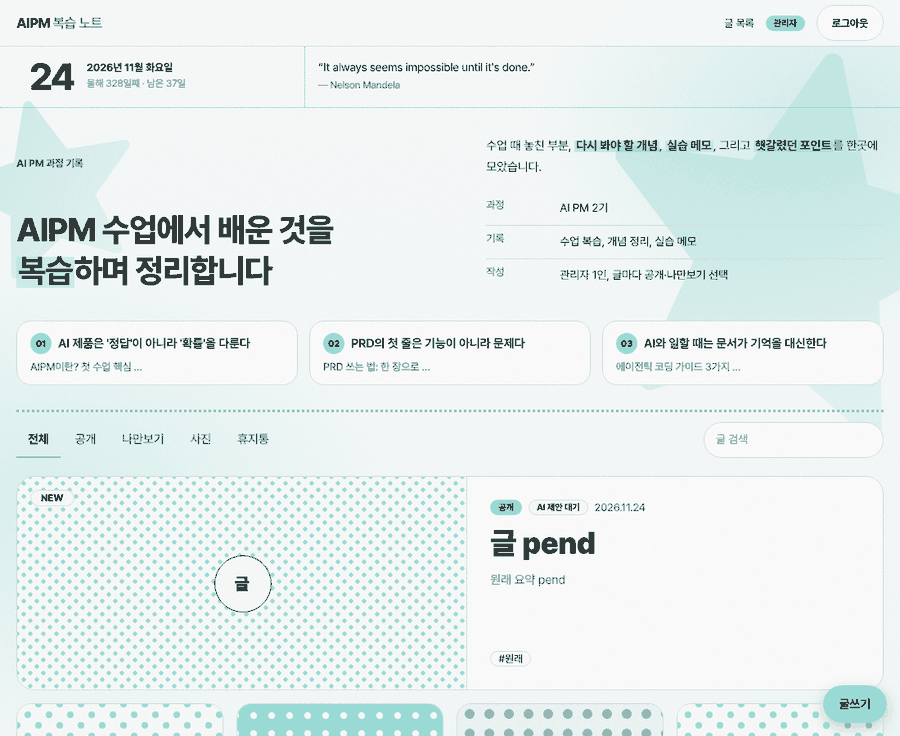
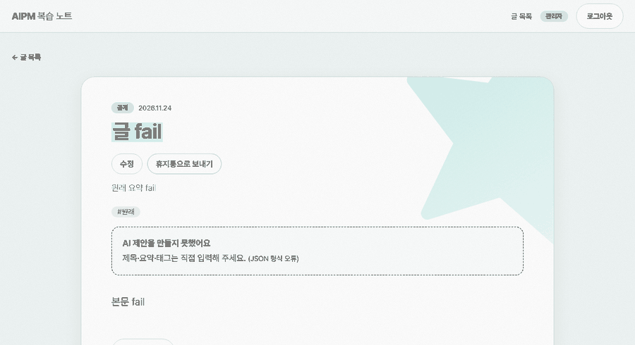
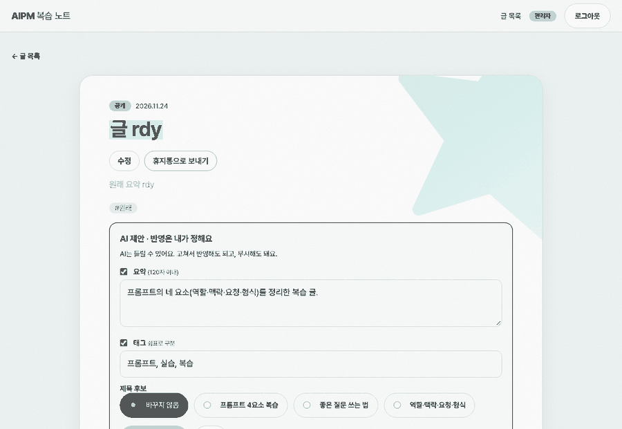
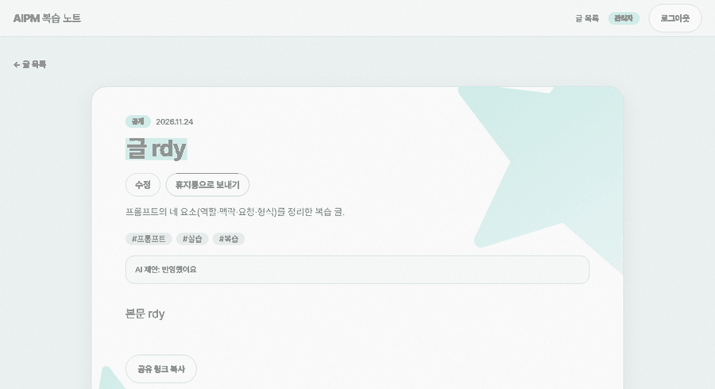
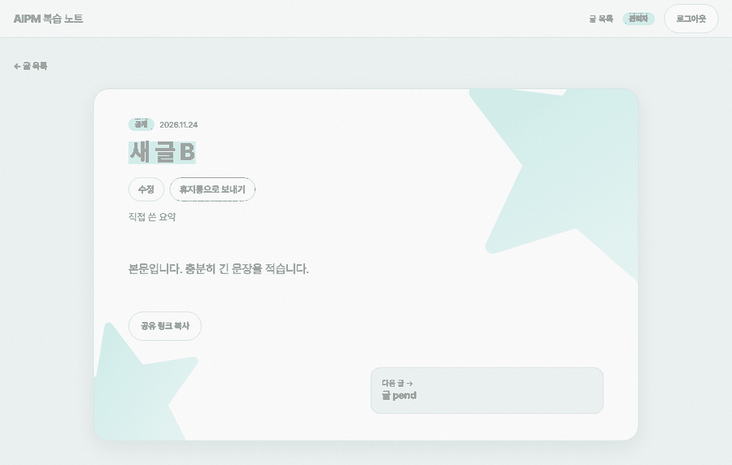
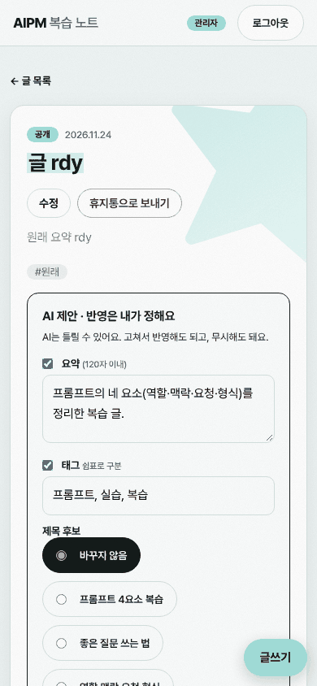

# 테스트 보고서 · AIPM 복습 노트 「AI 글 정리 도우미」

> **이 문서의 목적:** AI 제안 기능이 PRD의 요구(제안만 하고 승인 후에만 반영, 실패 시 안내, 하루 상한)대로 동작하는지 시험한 방법과 결과를 기록하고, 아직 시험하지 못한 부분을 숨기지 않고 적는다.

## 1. 기본 정보
**문서 버전** v0.1 · **작성일** 2026-11-24 · 대상: `index.html` v1.5, `scripts/gen-ai.mjs` · 관련: [PRD 홈](PRD홈_AIPM복습노트_AI글정리도우미_하늘_20261124.md)

## 2. 시험 범위와 환경
| 구분 | 방법 | 결과 |
|---|---|---|
| 단위 테스트(배치) | `npm test` (Node 22, 가짜 저장소·가짜 AI 응답) | **13/13 통과** |
| 화면 시험(사용자 흐름) | Playwright 자동 조작, Firebase를 가짜로 대체(`scripts/ui-check.mjs`) | **15/15 통과** |
| 실서비스 시험 | 실제 Firebase·실제 AI 호출·GitHub Actions 실행 | **미시험** (5장) |

## 3. 단위 테스트 (13건)
| ID | 확인한 것 | 결과 |
|---|---|---|
| UT-01~02 | 제안이 `ai*` 필드에만 저장됨, 태그의 `#`·중복 정리, `title`·`summary`·`tags` 쓰기는 차단 | 통과 |
| UT-03~04 | 잘못된 응답이면 1회 재시도 후 `failed`(호출 2번), 재시도에서 성공하면 `ready` | 통과 |
| UT-05~06 | 하루 상한까지만 호출하고 나머지는 대기로 남김, 날짜(한국시간)가 바뀌면 초기화 | 통과 |
| UT-07~08 | 이미지만 있는 글은 호출 없이 실패 처리, 이미지·태그 제거, 6,000자 제한 | 통과 |
| UT-09~10 | 요약 120자 초과·태그/제목 없음·JSON 아님 거절, 글 속 지시문 무시 프롬프트 | 통과 |
| UT-11 | API 키가 요청 본문·오류 메시지에 섞이지 않음 | 통과 |
| UT-12~13 | 기준값(자동 대체 비율) 계산, 한국시간 날짜 경계(UTC 15:00) | 통과 |

## 4. 사용자 흐름 시험 (15건, 화면 캡처)
| 흐름 | ID | 확인한 것 | 결과 |
|---|---|---|---|
| 목록 | UI-01~02 | 관리자만 「AI 제안 대기·도착」 칩이 보이고, 로그아웃하면 보이지 않음 | 통과 |
| 상태 카드 | UI-03~04 | 대기 중 안내+확인 버튼, 실패 시 「직접 입력」 안내(반영 버튼 없음) | 통과 |
| 반영 | UI-05~08 | 기본 반영 시 요약·태그만 바뀌고 제목은 그대로, 고쳐서 반영하면 `edited`, 제목 후보 선택 | 통과 |
| 거절·무시 | UI-09~11 | 태그 체크 해제 시 태그 유지, 무시하면 글 그대로, 권한 거부 시 안내 문구 | 통과 |
| 안전 | UI-12 | AI 결과에 HTML·스크립트가 있어도 실행되지 않고 글자로만 표시 | 통과 |
| 저장 | UI-13~14 | 「AI 제안 받기」 체크 시 `pending`, 해제 시 `none`, 요약을 비우면 `summaryAuto` 기록 | 통과 |
| 모바일 | UI-15 | 390px 화면에서 가로로 넘치지 않음 | 통과 |

  
  

왼쪽 위부터: 목록 칩(UI-01), 실패 카드(UI-04), 제안 카드(UI-05), 반영 후(UI-06), 글쓰기 체크(UI-13), 모바일(UI-15)

## 5. 시험하지 못한 것과 한계
- **실제 AI 응답:** Secrets가 없어 AI를 한 번도 호출하지 않았다. 요약 품질은 평가하지 못했고, 수락률도 측정 전이다.
- **실제 Firebase:** 규칙에서 관리자 수정이 허용되는지 확인하지 못했다(결정 #30). 허용되지 않으면 반영 버튼이 거부된다(UI-11은 가짜 거부로만 확인).
- **GitHub Actions:** 워크플로를 실행해 본 적이 없다. 로컬은 Node 22, Actions는 Node 20이다.
- **화면 캡처:** 가짜 Firebase 위에서 찍은 화면이라 실제 사이트 캡처가 아니다.
- **시험하다 막힌 일:** 화면 시험 첫 실행에서 가짜 Firebase에 `getFirestore`가 없어 실패했고 보강 후 통과했다. 이 세션에서는 `git push`(403)와 Firestore 읽기(403)도 막혀 웹 편집기로 올리고 기준값은 측정하지 못했다([깃 푸시 403 실패 로그](실패로그_AIPM복습노트_깃푸시403_하늘_20261117.md)).

## 6. 다음 시험 (Secrets 설정 뒤)
1. Actions에서 `ai-suggest`를 mode=baseline으로 실행해 V1(자동 대체 비율)을 기록한다.
2. 글 1편을 「AI 제안 받기」로 저장하고 수동 실행 후 제안 카드가 도착하는지 확인한다.
3. 제안을 반영해 성공하는지, 시크릿 창에서 수정이 거부되는지 확인한다. 결과는 이 문서 v0.2에 쓴다.
