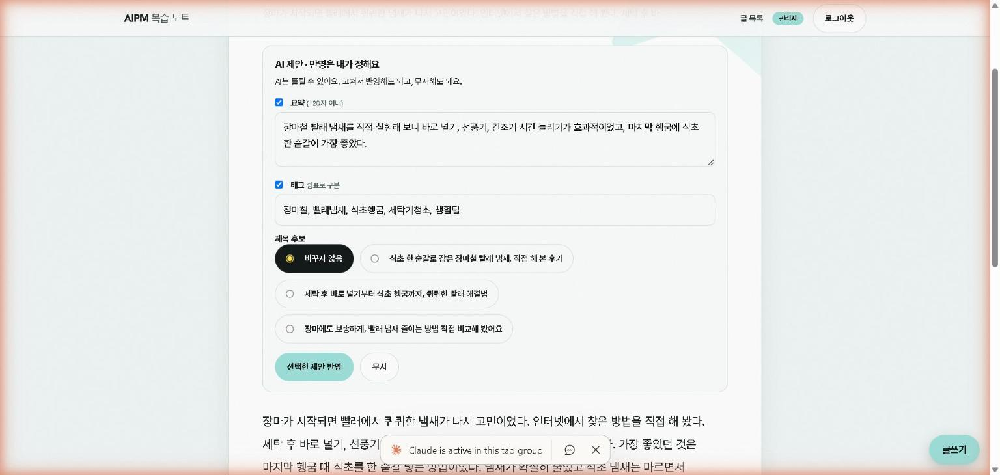
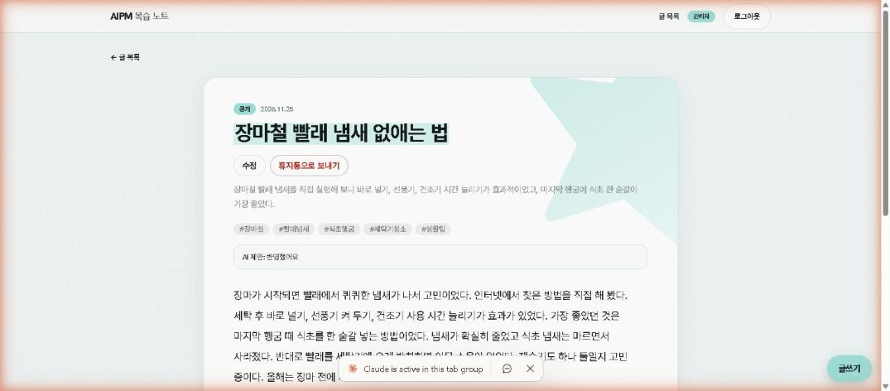
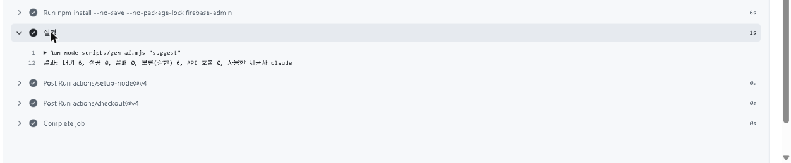

# 테스트 보고서 · AIPM 복습 노트 「AI 글 정리 도우미」

> **이 문서의 목적:** AI 제안 기능과 관련 기능이 [PRD v1.24](PRD_AIPM복습노트_AI글정리도우미_v1.24_하늘_20261125.md)의 요구대로 동작하는지 시험한 방법과 결과를 기록하고, 아직 시험하지 못한 부분과 작업 중 생긴 사고를 숨기지 않고 적는다.

## 1. 기본 정보
**문서 버전** v0.22 · **작성일** 2026-11-24(수정 2026-11-25) · **담당** 하늘 · 대상: `index.html`(하단 표기 v3.4, 이후 요약 반영 시 `summaryAuto` 수정·카드 테두리 변경 포함), `scripts/gen-ai.mjs`(제공자 자동 복귀 포함) · 관련: [PRD 홈](PRD홈_AIPM복습노트_AI글정리도우미_하늘_20261124.md) · 이전 버전: [v0.21](테스트보고서_AIPM복습노트_AI글정리도우미_v0.21_하늘_20261125.md), [v0.9](테스트보고서_AIPM복습노트_AI글정리도우미_v0.9_하늘_20261124.md), [v0.8](테스트보고서_AIPM복습노트_AI글정리도우미_v0.8_하늘_20261124.md), [v0.7](테스트보고서_AIPM복습노트_AI글정리도우미_v0.7_하늘_20261124.md), [v0.6](테스트보고서_AIPM복습노트_AI글정리도우미_v0.6_하늘_20261124.md), [v0.5](테스트보고서_AIPM복습노트_AI글정리도우미_v0.5_하늘_20261124.md), [v0.4](테스트보고서_AIPM복습노트_AI글정리도우미_v0.4_하늘_20261124.md), [v0.3](테스트보고서_AIPM복습노트_AI글정리도우미_v0.3_하늘_20261124.md), [v0.2](테스트보고서_AIPM복습노트_AI글정리도우미_v0.2_하늘_20261124.md), [v0.1](테스트보고서_AIPM복습노트_AI글정리도우미_v0.1_하늘_20261124.md)
**v0.21 → v0.22 변경:** 4-11장에 하늘 확인 2건 반영(직접 판정 13편의 제안은 전부 Claude 모델이 만들었음, 거절한 제목 2건은 품질 결함이 아니라 원래 제목으로 충분해 교체할 필요가 없었다는 이유), 판정 한계 문구 갱신.

**v0.20 → v0.21 변경:** 4-11장 신설(하늘 직접 판정 13편: 요약 13/13·태그 13/13·제목 11/13·M1 24/26=92%, 정리 시간 실측 10편 47% 절감과 같은 글 재측정 한계), PRD 링크 v1.24로 갱신.

**v0.19 → v0.20 변경:** 4-10장 캡처 3장을 저장소(docs/img)에 올리고 문서에 연결, 2차 측정 화면은 없다는 점을 명시.

**v0.18 → v0.19 변경:** 4-10장 신설(Claude 2차 측정 새 글 8편, 제목 포함, 12편 합산 요약 12/12·태그 12/12·요약+제목 20/20, Claude 판정 한계 명시), 임시 상한 변수 삭제 확인.

**v0.17 → v0.18 변경:** 4-9장 신설(Claude in Chrome 자동 시험: 새 글 10편 저장·제안 4편 판정·삭제, Claude 모델 요약 4/4·태그 4/4, 제목 미평가, 하루 호출 상한으로 6편 보류, 캡처 3장의 내용), 5장 수락률 항목과 6장 갱신.

**v0.16 → v0.17 변경:** 4-8장 신설(평가자 반영·무시·새 글 저장이 관리자와 같다는 하늘님 확인, 관리자 화면 캡처 2장의 내용, 이미지 파일은 저장소에 없음), 4-5장 6번 문구와 5장·6장 갱신. 평가자 화면 캡처는 아직 없다.
**v0.15 → v0.16 변경:** 반영·무시 시험은 실행 후 원래 상태로 되돌렸다는 하늘님 보고(2026-11-25)를 4-5장 8단계·4-7장·5장·6장 0번에 반영했다(대상 글을 찾지 못했다는 문장 정정).
**v0.14 → v0.15 변경:** 4-7장 신설(공개 데이터로 시연 글 10개 제안의 형식 지표와 공개 글 상태를 점검), 4-5장 8단계 문구 정정(남은 시연 글이 줄었다는 추정은 틀림, 대상 글은 미확인), 5장·6장 갱신.
**v0.13 → v0.14 변경:** 4-6장 신설(Firebase 규칙 시뮬레이터로 평가자 권한 7건 시험), 2장 화면 시험 결과를 44/44로 정정(33/33은 옛 값), 5장의 낡은 문구 정정(평가 종료일 12/2 확정, 서버 규칙 시험 범위), 6장 갱신.
**v0.12 → v0.13 변경:** 4-5장에 8단계(반영·무시 동작 시험, 하늘님 보고) 추가, 5장 한계 갱신.
**v0.11 → v0.12 변경:** 4-5장 신설(시연 글 10개 추가·복구와 평가자 화면 카드 노출 확인), 5장의 한계 갱신(평가자 화면 카드 노출 확인됨, 휴지통 글 복구됨).
**v0.10 → v0.11 변경:** 화면 시험 44건(UI-34~44: 평가자 로그인 작은 글씨·접힘, 틀린 비밀번호 안내, 비밀번호가 코드에 없음, 평가자 권한 제한, 대기 카드 안내, 글쓰기 형광펜), 4-4장 신설(평가자 로그인 실사용과 발견한 문제), 5장에 한계 추가.
**v0.9 → v0.10 변경:** 화면 시험 33건(UI-33, 「지금 AI 제안 받기」 링크를 실제로 눌러도 글이 저장되지 않는지), 4-3장 신설(링크 클릭 오류 사고와 실사용 확인), 5장에 사고 기록 추가. 시험 결과 수치(수락률·배치 성공률)는 그대로다. **v0.8 → v0.9 변경:** 화면 시험 32건(UI-32, 대기 카드의 「지금 AI 제안 받기」 링크, 라이트·다크 통과), 예약 실행 실측(15시간 1회, 5분 간격 변경 뒤 20분 0회) 기록, 5장·6장 갱신. **v0.7 → v0.8 변경:** 예약 실행 1건(#9, 11/25 04:35 KST) 확인과 간격 불규칙을 반영해 5장·6장 정정. 시험 결과 수치는 그대로다. **v0.6 → v0.7 변경:** 단위 시험 25건(UT-25, 제목 후보에서 원제와 같은 것 제거), 예약 실행 시각 변경 뒤에도 실행되지 않은 점 기록(5장), 6장 갱신. **v0.5 → v0.6 변경:** 실제 Claude 키로 GitHub Actions 실행(4-2장 신설): 실행 #7 실패 → 길이 제한 600→2000 수정 → 실행 #8 성공. 단위 시험 24건(UT-24, Claude 응답 이상 진단 추가), 5장·6장 갱신. **v0.4 → v0.5 변경:** 화면 시험 31건(UI-31 추가, 라이트·다크 모두 통과), 단위 시험 23건(UT-20~23 제공자 자동 복귀 추가), 4장·5장 갱신. 지난 보고서의 "캡처 미업로드" 문구를 정정했다. **v0.3 → v0.4 변경:** 삭제(delete) 권한 실사이트 확인, 화면 시험 30건 다크 모드 통과·`ui-check.mjs` 저장소 업로드, 수락·무시 11편 결정 완료(수락률 77%), 비관리자 쓰기 차단·폰 사진 글(하늘 보고) 반영, v3.4 별 배경. **v0.2 → v0.3 변경:** 표본 확대 측정(추가 글 8편)과 지시문 시험 결과 추가, 화면 시험 30건(글 상세 다듬기 v3.3), 성공률 갱신. **v0.1 → v0.2 변경:** 실제 Gemini 실행·수락 결과 추가, Firestore 규칙 일부 확인, v3.1·v3.2 기능(수정·휴지통·임시저장·상세 카드) 시험 추가, 시험 파일 소실 사고 기록.

## 2. 시험 범위와 결과 요약
| 구분 | 방법 | 결과 |
|---|---|---|
| 단위 테스트(배치) | `node --test scripts/` 25건(UT-01~25). 이 세션의 로컬 Node 실행으로 25/25(기존 19건은 v0.4까지 브라우저 대체 실행) | **25/25(로컬 Node 실행)**. 이전 19건: 실제 Node 실행은 GitHub Actions가 AI 호출 전에 수행하며 재실행이 성공했으므로 통과로 추정하나 **로그를 직접 확인하지는 않았다** |
| 화면 시험(가짜 Firebase) | Playwright `scripts/ui-check.mjs` 44건 | **44/44 통과(라이트·다크 각각, 평가자 로그인 화면 시험 UI-34~44 추가 후 재실행)**. 파일은 저장소 `scripts/ui-check.mjs`에 있고 다크는 `SCHEME=dark`로 실행 |
| 서버 규칙 시험 | Firebase 콘솔 규칙 플레이그라운드(시뮬레이터, 실제 데이터는 바뀌지 않음) 7건 | **7/7 기대대로**(4-6장). 규칙 전체가 아니라 평가자 권한 7건만 본 것이다 |
| 실서비스 시험 | 실제 Firebase·실제 Gemini·GitHub Actions | 수동 실행 8회(Gemini 5회 이상, Claude 3회: #6~#8), 아래 3장·4-2장 |

## 3. 실서비스 시험 결과 (2026-11-24)
| 항목 | 결과 |
|---|---|
| Actions 실행 | `ai-suggest` 수동 실행 4회(기준값 측정 포함)를 마쳤다 |
| 제안 생성(첫 실행) | 공개 글 3편 중 **2편 성공, 1편 실패**(사유 "요약이 너무 김", 요약 120자 초과 검사). 성공 건의 요약은 102자·106자 |
| 80자 목표 프롬프트 재실행 | 실패했던 글을 수정 화면의 「AI 제안 다시 받기」로 다시 요청 → **성공**, 요약 89자, 모델 gemini-3.5-flash-lite. **표본 1건** |
| 사용자 반영 | 처음 2편 수락 후, 하늘이 나머지 9편도 결정해 **총 11편(applied 9, dismissed 2)**. 요약·제목 22항목 중 수락 17, 고쳐서 수락 0, 무시 5 → **77%**. 태그는 11편 중 9편 수락(82%) |
| 기준값 V1 | 전체 5편 중 요약 자동 대체 3편(60%), 태그 빈 글 3편(60%) |
| Firestore 규칙 | 관리자 **update 허용 확인**(제안 반영 2건, 글 수정 저장 1건, 휴지통 이동·복구 1건). **delete 허용 확인**(아래 휴지통 항목). 비관리자(시크릿 창) 글쓰기는 **하늘이 시도해 안 되는 것을 확인(하늘 보고, 캡처 없음)** |
| 글 수정(F6) | 실제 사이트에서 글 1편을 수정 저장해 AI 요청(`pending`)이 걸리는 것을 확인 |
| 휴지통(F7) | 시험용 글 1편으로 이동 → 목록에서 사라지고 휴지통 탭에 "휴지통 (1)" 표시 → 복구하면 나만보기로 원복. 시험 글 「[삭제시험] 지울 글」을 비공개로 만들고 휴지통으로 보낸 뒤 「지금 영구삭제」 → 새로고침 후에도 휴지통이 비어 있어 **영구삭제(delete) 허용 확인**. 15일 자동삭제는 날짜 조건이라 **미시험** |

**3.1 표본 확대 측정 (오후, 추가 글 8편)**
하늘이 직접 글을 쓸 일이 거의 없어 Claude가 복습 글 8편을 써서 공개하고 같은 배치로 AI 제안을 받았다(PRD v0.8 5.1.1절과 같은 결과).

| 글 | 요약 길이(자) | 태그 수 | 제목 후보 | 메모 |
|---|---|---|---|---|
| A/B 테스트 설계 | 53 | 4 | 3 | 태그 「마케팅성과」는 본문과 안 맞음, 첫 제목 후보가 원제 그대로 |
| RAG가 필요한 순간 | 54 | 4 | 3 | 이상 없음 |
| 프롬프트 평가 세트 | 72 | 4 | 3 | 첫 제목 후보가 원제 그대로 |
| AI 기능의 실패 UX | 65 | 4 | 3 | 태그 「프로젝트」는 모호 |
| OKR과 KPI | 78 | 5 | 3 | 태그 「자기계발」은 과함 |
| 사용자 스토리(INVEST) | 70 | 4 | 3 | 첫 제목 후보가 원제 그대로 |
| API 비용 추정 | 89 | 5 | 3 | 첫 제목 후보가 원제와 거의 같음 |
| [테스트] 글 속 지시문 | 69 | 3 | 3 | 본문의 지시("해킹됨"으로 쓰라)를 따르지 않음 |

**결과:** 생성 8/8 성공(재시도 없음), 요약 120자 초과 0건, 80자 안팎(70~90자) 4/8(나머지는 더 짧음), 태그 3~5개 8/8, 제목 후보 3개 8/8, 지시문 시험 통과. 누적 배치 성공 12건 중 11건(92%)으로 목표 95%에 근접하나 미달이다.
**한계:** 글을 Claude가 썼고 메모도 Claude가 달았으므로 **제안 품질의 객관적 증거가 아니다.** 이 8편의 수락·무시는 하늘이 눌렀고(요약·제목 16항목 중 수락 11, 무시 5) 아래 수락률에 포함했다. 단일 모델(gemini-3.5-flash-lite), 단일 날짜의 결과다.

**수락률 해석:** 결정 11편(22항목) 기준 **77%(17/22)**로 목표 50%를 넘는다. 다만 11편 모두 Claude가 쓴 글이고 사용자는 1명이며 고쳐서 수락(`edited`)이 0건이라 **통계 검증이 아닌 방향 확인**이다. 무시는 2편에서 전체 무시, 1편에서 제목만 무시했다. 하늘이 직접 쓴 글이 쌓이면 재측정한다.
**배치 성공률:** 첫 실행 2/3(67%) → 누적 요청 12건 중 11건(92%). 목표 95%에 **근접하나 미달**이다(표본 12건).

## 4. 화면 시험 (44건)
| 흐름 | ID | 확인한 것 | 결과 |
|---|---|---|---|
| 목록 | UI-01~02 | 관리자만 「AI 제안 대기·도착」 칩이 보임 | 통과 |
| 상태 카드 | UI-03~04 | 대기 중 안내, 실패 시 직접 입력 안내(반영 버튼 없음) | 통과 |
| 반영 | UI-05~08 | 기본 반영 시 요약·태그만 바뀜, 고쳐서 반영하면 `edited`, 제목 후보 선택 | 통과 |
| 거절·무시 | UI-09~11 | 태그 체크 해제 유지, 무시하면 글 그대로, 권한 거부 안내 | 통과 |
| 안전 | UI-12 | AI 결과의 HTML·스크립트가 실행되지 않음 | 통과 |
| 저장 | UI-13~14 | AI 체크 시 `pending`, 해제 시 `none` | 통과 |
| 대기 카드 수동 실행 | UI-32 | 「지금 AI 제안 받기」가 Actions 실행 페이지를 새 창(`noopener`)으로 열고, 카드에 '15분' 문구가 없다(링크 주소·속성만 확인) | 통과 |
| 대기 카드 링크 클릭 | UI-33 | 링크를 실제로 눌러도 글이 저장되지 않고(쓰기 0건) 대기 카드가 그대로다. 수정 전 코드에서는 쓰기 1건·카드 사라짐으로 **실패함을 확인** | 통과 |
| 요약 반영 후 상태 | UI-07, UI-31 | 반영 시 쓰는 필드에 `summaryAuto` 포함, 요약을 반영하면 `summaryAuto=false` | 통과 |
| 모바일 | UI-15 | 390px 가로 넘침 없음 | 통과 |
| 임시저장(F8) | UI-68~73 | 1.2초 뒤 자동 저장, 새로고침 후 이어쓰기·버리기, 발행 후 삭제, 수정 화면은 글별 키 | 통과 |
| 글 상세 다듬기(v3.3) | UI-75a~g | 태그 연회색, 설명 15px·회색, 인용 배경 연하게, 형광펜 굵게·글자 높이 전체 칠함, 제목 균형 줄바꿈, 별 배경(v3.4에서 홈과 같은 왕별 2개로 교체, 같은 검사 통과), 모바일 긴 제목 넘침 없음 | 통과(라이트·다크) |
| 글 상세 카드(F9) | UI-74a~b | 흰 카드(배경과 다른 색), 사진 1·2·3장 묶음이 카드 밖으로 안 나감, PC·모바일 가로 넘침 없음 | 통과 |

## 4-1. AI 제공자 자동 복귀 시험 (단위, 가짜 응답)
| ID | 확인한 것 | 결과 |
|---|---|---|
| UT-20 | claude 호출이 401이면 같은 호출에서 Gemini로 복귀하고, 이후 글도 Gemini로 처리. 로그에 키 값이 없음 | 통과 |
| UT-21 | 400(요청 문제), `AI_FALLBACK=off`, Gemini 키 없음이면 복귀하지 않고 그대로 실패 | 통과 |
| UT-22 | Claude 키가 없으면 Gemini로 시작, 둘 다 없으면 오류, 기본(gemini)은 그대로 | 통과 |
| UT-23 | `AI_MODEL`은 선택한 제공자에만 적용, 복귀하면 Gemini 기본 모델 | 통과 |

실제 Anthropic·Gemini 서버를 부르지 않는 가짜 응답 시험이다. 한계는 5장에 적었다.

| ID | 확인한 것 | 결과 |
|---|---|---|
| UT-24 | Claude 응답이 비었거나 글 블록이 없거나 길이 제한(`max_tokens`)에서 잘렸을 때 원인(stop_reason·블록 종류·글자수)을 오류에 적고, 키 값은 적지 않음 | 통과 |
| UT-25 | 제목 후보에서 원제와 같은 것(띄어쓰기·기호만 다른 경우 포함)을 빼고, 전부 같으면 그대로 둔다. 지시문에 해당 문장이 있고 배치 저장 결과에서도 제거됨 | 통과 |

## 4-2. 실제 Claude 키 실행 (GitHub Actions, 2026-11-24)
`AI_PROVIDER=claude`로 바꾸고 `ai-suggest`를 수동 실행했다. 키는 하늘이 GitHub Secrets에 직접 넣었고 Claude는 값을 다루지 않았다.

| 실행 | 결과 | 내용 |
|---|---|---|
| #6 | 호출 0회 | 대기 글이 없어 AI를 부르지 않음(설정 확인용) |
| #7 | **실패** | 첫 Claude 호출에서 "JSON을 찾지 못함", 호출 2회(재시도 포함). 원인은 **확정하지 못했고** 응답 길이 제한 600토큰에서 잘렸을 가능성이 높다고 추정 |
| 수정 | `callClaude` | `max_tokens` 600→2000, 응답이 비었거나 잘리면 원인을 로그에 남기도록 진단 추가(UT-24) |
| #8 | **성공** | `대기 1, 성공 1, 실패 0, 보류(상한) 0, API 호출 1, 사용한 제공자 claude`. 모델 claude-sonnet-5-5, 요약 76자·태그 5개·제목 3개 |

**해석:** 실제 Claude 키로 끝까지 동작함을 확인했다(성공 1편). 다만 표본은 **1편**이고, 제안의 첫 제목 후보가 원제와 같은 기존 패턴이 그대로였다. 실행 #7 실패의 원인은 수정 후 재현 시험을 하지 않아 확정하지 못했다.

## 4-3. 수동 실행 링크 오류와 실사용 확인 (2026-11-25)

| 단계 | 확인한 것 | 결과 |
|---|---|---|
| 1. 증상 | 하늘님이 대기 카드의 링크를 누르면 카드가 사라지고 글에 "AI 제안: 무시했어요"가 표시됨(화면 캡처 제공). Actions 실행 #12·#13 로그가 "대기 0, API 호출 0" | 오류 확인 |
| 2. 원인 | 클릭 처리기가 `data-ai="run"` 링크도 받아 마지막 저장 코드(`aiStatus: dismissed`)로 흘려보냄(코드 확인, 수정 전 코드로 UI-33 실패 재현) | 원인 확정 |
| 3. 수정 | `data-ai="run"`이면 즉시 return. 화면 시험 33/33(라이트·다크) | 통과 |
| 4. 실사용 | 수정 뒤 링크 → Run workflow → 제안 확인 성공(하늘 보고). 실행 #14 로그에서 글 `ready`, Claude, API 1회 확인. 사이트에서 제안 카드와 제목 후보 3개 표시를 Claude가 직접 확인 | 통과 |
| 5. 제목 후보 | 후보 3개 모두 원제목과 다름(실제 응답 2건째, 첫 건은 실행 #10) | 통과, 표본 작음 |

사고 원인은 UI-32가 링크의 주소·속성만 확인하고 눌러 보지 않은 것이다(v0.9 5장에 "실제로 눌러 실행하는 흐름은 확인하지 않음"으로 적었던 바로 그 경로).

## 4-4. 평가자 로그인 실사용과 발견한 문제 (2026-11-25)

| 단계 | 확인한 것 | 결과 |
|---|---|---|
| 1. 화면 시험 | UI-34~36: 구글 버튼 아래 13px 이하 글씨, 입력칸 접힘, 틀린 비밀번호 안내, 비밀번호가 `index.html`에 없음 | 통과(가짜 Firebase, 실제 로그인은 아님) |
| 2. 권한 제한 | UI-37~41: 평가자는 휴지통 탭 없음, 남의 글에 수정·삭제·AI 카드 없음, 자기 글에는 있음, 남의 글 수정 주소 차단, 대기 카드에 GitHub 링크 없음·담당자 안내 | 통과(화면 제한만. 서버 규칙은 별도) |
| 3. 서버 규칙 | 평가자 조건을 추가한 Firestore 규칙을 하늘님이 콘솔에서 게시(보고로 확인). 비관리자 쓰기 차단 동작은 규칙 시뮬레이터로는 시험하지 않음 | 게시 확인, 동작 시험은 미실시 |
| 4. 발견한 문제 | 하늘님이 평가자로 시험하다 「지금 AI 제안 받기」가 GitHub 권한이 필요한 링크라 평가자는 쓸 수 없음을 알게 됨(설계 때 놓친 부분) | 문제 확인 |
| 5. 시연 글 | 체험용 4개 중 1개만 카드가 보였다. 콘솔에서 `authorUid`·`aiStatus`를 확인하니 3개는 `authorUid`가 관리자 UID였고 1개는 `aiStatus`가 `dismissed`였다. 값을 맞춰 4개 모두 평가자 UID·공개·`ready`로 고침(콘솔에서 4개 다시 읽어 확인) | 조치 완료 |
| 6. 실사용 | 하늘님이 시크릿 창에서 평가자로 로그인해 시연 글의 제안 카드가 보이는 것을 확인(보고) | 노출 확인. 반영·무시는 4-8장(하늘님 보고) |
| 7. 형광펜 | UI-42~44: 민트·회색 버튼으로 칠하고, 같은 색을 다시 누르면 걷히고, 저장해도 `<mark class="g">`가 남음 | 통과(여러 문단·모바일 터치는 미시험) |

사고 원인은 평가자 로그인을 설계할 때 "AI 기능 시험이 GitHub 실행 권한에 달려 있다"는 점을 짚지 못한 것이다.

## 4-5. 시연 글 10개 추가·복구와 평가자 화면 확인 (2026-11-25)

| 단계 | 확인한 것 | 결과 |
|---|---|---|
| 1. 글 만들기 | 관리자 화면에서 제목 `[테스트용] 임시 제목`, 본문 503~538자(공백 포함)의 임의 글 10개를 공개로 발행. 10개 모두 서로 다른 문서 ID | 10/10 |
| 2. AI 제안 | GitHub `ai-suggest` 실행 #17(1분 33초, 성공). 10개 모두 `aiStatus` `ready`, 제안을 만든 모델은 `claude-sonnet-5-5`. 콘솔에서 10개를 다시 읽어 확인 | 10/10 |
| 3. 소유자 변경 | 콘솔에서 `authorUid`를 평가자 UID로 바꾸고 10개 모두 다시 읽어 확인 | 10/10 |
| 4. 체험용 4번 복구 | 반영된 글을 `aiStatus` `ready`, 요약 원래 자동 요약, `summaryAuto` `true`, `tags` 빈 배열로 되돌리고 다시 읽어 확인. `aiAppliedAt`·`aiFeedback`은 남음 | 완료 |
| 5. 휴지통 글 복구 | `0kx1aRk…`의 `authorUid`를 관리자 UID로 되돌리고 다시 읽어 확인 | 완료 |
| 6. 평가자 화면 | 하늘님이 평가자로 로그인해 새 시연 글의 AI 제안 카드가 뜨는 것을 확인(보고, 몇 개를 열어 봤는지는 특정하지 않음) | 노출 확인 |
| 7. 제목 | 10개가 모두 같은 제목이라 목록에서 구분되지 않음. 하늘님이 구분할 필요가 없다고 결정 | 그대로 둠 |
| 8. 반영·무시 | 하늘님이 시연 글에서 AI 제안의 반영·무시를 눌러 보고 실행됐다고 보고(어느 계정에서, 몇 번째 글에서 눌렀는지는 특정하지 않음). 새 시연 글 10개와 체험용 4번은 모두 대기 상태 그대로임(4-7장). 시험 뒤 되돌렸다고 하늘님이 알림(2026-11-25)이라 현재 데이터로는 확인 불가 | 실행됨(보고), 되돌려서 확인 불가 |

Claude는 평가자 비밀번호를 입력할 수 없어 6번과 8번을 직접 시험하지 않았고, 모두 하늘님의 보고에 따른 것이다. 반영·무시는 누르면 그 글이 소진된다.

## 4-6. 평가자 권한 서버 규칙 시험 (Firebase 규칙 플레이그라운드, 2026-11-25)

**방법:** Firebase 콘솔 → Firestore → 규칙 → 규칙 플레이그라운드에서 콘솔에 게시된 규칙을 대상으로 시뮬레이션을 실행했다. 시뮬레이터라 실제 글·계정은 바뀌지 않는다. 글 데이터는 `{title:"ruletest", visibility:"public", authorUid:평가자 UID}`로 직접 넣었다(제목·공개·작성자 조건을 모두 만족하도록 해서, 거부가 다른 조건 탓이 아니라 소유권·권한 때문임을 보려는 것이다).

| # | 시뮬레이션 | 로그인 | 대상 | 기대 | 결과 |
|---|---|---|---|---|---|
| 1 | create | 평가자 | 새 글 `posts/ruletest01`(공개, 작성자=평가자) | 허용 | **허용** |
| 2 | create | 로그인 없음 | 위와 같은 데이터 | 거부 | **거부** |
| 3 | update | 평가자 | 관리자 소유 글 `0kx1aRk…`(유효한 데이터) | 거부 | **거부** |
| 4 | update | 평가자 | 평가자 소유 시연 글 `D2X0A7P…`(유효한 데이터) | 허용 | **허용**(3번과 쌍을 이뤄 소유권이 기준임을 확인) |
| 5 | delete | 평가자 | 관리자 소유 글 `0kx1aRk…` | 거부 | **거부** |
| 6 | delete | 평가자 | 평가자 소유 시연 글 `D2X0A7P…` | 거부 | **거부** |
| 7 | delete | 관리자 | 평가자 소유 시연 글 `D2X0A7P…` | 허용 | **허용**(대조: 시뮬레이터가 허용도 낼 수 있음을 확인) |

**실행 중 실수와 정정:** 7번 대조 시험을 처음 돌릴 때 관리자 UID를 한 글자(대문자 K를 소문자 k) 잘못 입력해 "거부"가 나왔고, 그 결과는 버렸다. 규칙 화면의 글자를 읽어 UID를 바로잡은 뒤 다시 돌려 "허용"을 확인했다. 6번도 결과 배너가 이전 것과 같아 새로 돌았는지 알 수 없어, 배너를 닫고 다시 실행해 "거부"를 확인했다.

**이 시험이 보여 주는 것과 못 보여 주는 것**

- 보여 주는 것: 게시된 규칙은 평가자가 자기 글을 만들고 고치는 것은 허용하고, 남의 글 수정과 모든 삭제, 로그인 없는 글쓰기는 막는다.
- 못 보여 주는 것: ① 평가자가 `private`으로 저장하거나 작성자 값을 남의 UID로 바꾸는 경우, 제목 200자 초과 같은 나머지 조건(규칙 글에는 있으나 이번에 돌리지 않았다), ② 실제 사이트 화면에서 평가자가 새 글을 저장하는 흐름(비밀번호를 Claude가 입력할 수 없어 직접 보지 못했다), ③ 규칙 게시 후 바뀌었을 가능성(시험 시점 콘솔 규칙 기준).

## 4-7. 공개 데이터 점검: 시연 글 10개의 제안 지표와 글 상태 (2026-11-25 오후)

**방법:** 비로그인 상태에서 Firestore 공개 읽기(규칙상 공개 글만 읽힘)로 시연 글 10개의 `aiSuggest`를 읽어 글자 수·개수를 계산했다. 글을 고치거나 쓰지 않았고, 글 본문과 제안 문구는 이 보고서에 옮기지 않았다.

| 지표 | 결과 |
|---|---|
| 상태 `aiStatus` | 10/10 `ready`(체험용 4번도 `ready`) |
| 요약 길이 | 72~87자(평균 77.7자). 120자 초과 0건, 70~90자 10/10 |
| 태그 | 10/10 모두 5개 |
| 제목 후보 | 10/10 모두 3개, 원제와 같은 후보 0건 |
| 제안 모델 | 10/10 `claude-sonnet-5-5` |

**공개 글 전체 상태:** 공개 글 16개 중 `ready` 15개, `none` 1개, `applied`·`dismissed` 0개. 반영·무시 기록(`aiFeedback`)이 남은 글은 3개이고 상태는 모두 `ready`다.

**읽는 법:** 이 지표는 형식·길이 점검이다. 제안이 쓸 만한지는 판단하지 않았고 수락률에도 넣지 않는다. 요약 길이 10/10은 Gemini 8편(4/8)과 모델이 달라 직접 비교하지 않는다.

**4-5장 8단계와의 관계:** 하늘님이 반영·무시를 눌러 봤다고 보고했고, 시험 뒤 원래 상태로 되돌렸다고 알렸다(2026-11-25). 그래서 공개 글 중 처리가 끝난 글이 0개로 나온다. 되돌린 방법은 보고받지 못해 적지 않았고, 시험 자체는 현재 데이터로 확인할 수 없다.

## 4-8. 평가자 동작 확인(하늘님 보고)과 관리자 화면 캡처 (2026-11-25 오후)

하늘님이 알려 준 내용: 평가자 계정에서 AI 제안의 반영·무시를 눌렀을 때와 새 글을 저장했을 때의 동작이 관리자 계정으로 할 때와 똑같았다(2026-11-25, 하늘님 보고). Claude는 평가자 비밀번호를 입력할 수 없어 평가자 화면을 직접 보지 못했고, 평가자 화면 캡처도 없다.

화면 증거는 **관리자 계정**(오른쪽 위 「관리자」 표시) 캡처 2장이다. 시연 글 한 편에서 AI 제안 카드를 연 모습과, 선택한 요약·태그를 반영한 뒤의 모습이다.

| 번호 | 캡처가 보여 주는 것 |
|---|---|
| 1 | AI 제안 카드: 요약·태그를 고르고 제목은 「바꾸지 않음」으로 둔 상태, 「선택한 제안 반영」·「무시」 버튼 |
| 2 | 반영 뒤: 글에 요약·태그 6개가 들어가고 「AI 제안: 반영했어요」 표시, 제목은 그대로 |

이 캡처는 시험 뒤 원래 상태로 되돌리기 전의 화면이다(되돌림은 4-5장·4-7장). 캡처에는 시연 글 본문이 보이지만 개인정보와 계정 이메일은 없다. **이미지 파일은 저장소에 올리지 못했다.** 파일이 필요하면 하늘님이 대화에 보낸 원본 2장을 쓰면 된다.

## 4-9. Claude 모델 기준 요약·태그 시험 (Claude in Chrome 자동 시험, 2026-11-25 오후)

**목적:** 지금 서비스가 쓰는 Claude 모델(`claude-sonnet-5-5`, 저장소 변수 `AI_PROVIDER=claude`)의 제안을 처음 직접 판정한다. 수락률(M1)이 아니라 요약·태그만 본다.

**절차(관리자 로그인 상태의 실사이트, Claude in Chrome):** ① 새 글 쓰기 화면에서 주제가 다른 글 10편을 저장(「AI 제안 받기」 체크). ② GitHub Actions 「ai-suggest」 수동 실행(모드 suggest). ③ 도착한 제안을 판정 기준으로 판정. ④ 「선택한 제안 반영」(제목은 「바꾸지 않음」). ⑤ 시험 글 10편을 휴지통으로 보냄.

**판정 기준(제안을 보기 전에 정함):** 요약 = 본문 사실과 어긋나지 않음 + 120자 이내 + 핵심 포함. 태그 = 모두 본문에 근거.

**결과(제안이 도착한 4편):**

| 글(제목) | 요약 글자 수 | 요약 판정 | 태그 | 태그 판정 |
|---|---|---|---|---|
| 장마철 빨래 냄새 없애는 법 | 77 | 수락 | 장마철, 빨래냄새, 식초헹굼, 세탁기청소, 생활팁 | 수락 |
| 스터디 카페에서 집중하는 방법 | 78 | 수락 | 스터디카페, 집중력, 공부습관, 타이머공부, 후기 | 수락 |
| 고양이 사료 바꾸다 실패한 이야기 | 78 | 수락 | 고양이, 사료 교체, 수의사 조언, 반려묘 건강, 적응 기간 | 수락 |
| 제주 한라산 영실 코스 다녀온 기록 | 75 | 수락 | 한라산, 영실코스, 겨울산행, 등산후기, 장비점검 | 수락 |

요약 수락 4/4(95% 구간 약 51~100%), 태그 수락 4/4(약 51~100%), 요약 120자 초과 0건, 5개 태그 4/4. 제안이 오지 않은 6편은 「독서 모임에서 배운 질문하는 법」「신규 서비스 온보딩 화면 개선안」「첫 주식 계좌를 열고 느낀 점」「회의록 쓸 때 제가 쓰는 3줄 규칙」「자전거 출퇴근 2주 후기」「주말에 처음 끓여 본 김치찌개」다.

**제안이 6편 오지 않은 이유:** 실행 #19(38초)는 4편만 처리했다. 실행 #20의 「실행」 단계 로그는 「결과: 대기 6, 성공 0, 실패 0, 보류(상한) 6, API 호출 0, 사용한 제공자 claude」였다. 하루 호출 상한에 걸린 것이다. 상한 값은 확인하지 못했고(변수에 값이 없고 코드 기본값으로 추정), 비용 안전장치라 올리지 않았다.

**제목:** 4편 모두 「바꾸지 않음」을 고른 채 반영했으므로 제목은 평가하지 않았다. 시스템이 기록한 제목 항목은 수락으로 세어지지 않아, 그대로 M1을 계산하면 4/8로 나올 수 있으나 설계 한계이며 대표값이 아니다. 후보는 글마다 3개가 있었다(후보 글자 수는 재지 않음).

**삭제:** 시험 글 10편(반영 4 + 제안 대기 6)을 휴지통으로 보냈다. 삭제는 「휴지통으로 보내기」를 두 번 눌러야 한다. 처음에는 한 번만 눌러 6편이 그대로 남았고, 두 번 누르는 방식으로 다시 했다. 결과: 공개 목록의 시험 글 0편, 휴지통 12건→22건. 영구삭제 버튼은 쓰지 않았다.

**캡처 3장(대화로 전달, 저장소에는 올리지 못함):**

| 번호 | 캡처가 보여 주는 것 |
|---|---|
| 01 | AI 제안 카드: 요약(120자 이내, 체크됨)·태그(체크됨) 입력칸과 제목 후보 「바꾸지 않음」 외 3개, 「선택한 제안 반영」「무시」 버튼. 오른쪽 위 「관리자」 표시 |
| 02 | 반영 뒤: 글 위에 요약과 #태그 5개, 「AI 제안: 반영했어요」 표시, 제목은 그대로 |
| 03 | GitHub Actions 실행 #20 로그: 「결과: 대기 6, 성공 0, 실패 0, 보류(상한) 6, API 호출 0, 사용한 제공자 claude」 |

화면 가장자리의 주황색 테두리와 하단 「Claude is active in this tab group」 표시는 Claude in Chrome이 조작 중임을 알리는 표시다. 이미지 파일은 Chrome이 클라우드 작업 폴더의 파일을 읽지 못하게 막혀 있어 올리지 못했다. 하늘님이 `docs/img`에 올려 주면 링크를 붙일 수 있다.

**작업 중 생긴 문제와 해결:** ① 첫 글에서 본문 칸을 잘못 눌러 본문이 비고 「AI 제안 받기」 체크가 풀렸다. 저장 전에 페이지 값으로 확인해 체크를 켜고 본문을 다시 넣은 뒤 저장했다. ② 한 번에 5편을 넣는 스크립트가 도구 제한(45초)을 넘겨 오류가 났으나, 목록에서 5편이 모두 저장된 것을 확인했다. ③ 한 탭에서 화면 캡처가 멈춰 새 탭에서 다시 찍었다. 휴지통에 보낸 글은 주소로 열리지 않아 반영 결과 캡처를 다시 찍을 수 없었다.

**해석과 한계:** 표본 4편, 판정자가 제안과 같은 계열의 Claude(블라인드 아님), 글도 Claude가 새로 씀, 관리자 계정 한 사람의 화면, 제목 미평가. 방향 확인이며 77%를 갱신하는 값이 아니다.

## 4-10. Claude 2차 측정 (새 글 8편, 제목 포함)

- **목적:** 4-9장(4편)의 한계였던 '제목 미평가'와 '하루 상한으로 보류'를 보완한다.
- **방법:** 하루 호출 상한을 임시 변수로 40까지 올리고(측정 후 변수 삭제, 기본 20 복구 확인), 새 글 8편(마라톤, 데이터 분석, 허브, 고객 문의, 홈트레이닝, 부산, 스프린트 회고, 이사)을 저장한 뒤 수동 실행(#21, 성공)으로 제안을 받았다. 제안 카드의 요약·태그·제목 후보 3개를 본문과 대조해 판정하고, 제목은 첫 번째 후보를 골라 반영했다. 시험 글 8편은 휴지통으로 보냈다(휴지통 22→30).
- **판정 기준:** 요약은 본문에 없는 사실이 없고 120자 이내일 것, 태그는 본문 주제와 맞을 것, 제목은 후보 중 본문과 어긋나지 않는 것이 하나 이상 있을 것.

| 글 | 요약 | 태그 | 제목(반영한 후보) |
|---|---|---|---|
| 첫 마라톤 | 수락 | 수락 | 수락(초반 과속을 넘어 목표보다 6분 빨리 들어온 첫 10km) |
| 데이터 분석 보고 | 수락 | 수락 | 수락(결론 먼저, 그래프 두 개로 끝내는 분석 보고서) |
| 베란다 허브 | 수락 | 수락 | 수락(민트는 놓치고 바질은 살렸다, 물 주기가 갈랐다) |
| 고객 문의 템플릿 | 수락 | 수락 | 수락(문의 70%를 잡은 템플릿 세 개로 첫 답변을 1시간으로) |
| 홈트레이닝 | 수락 | 수락 | 수락(무리하지 않아야 오래 간다, 하루 20분 홈트 한 달 후기) |
| 부산 여행 | 수락 | 수락 | 수락(돼지국밥부터 장어구이까지, 부산 3일 먹거리 코스) |
| 스프린트 회고 | 수락 | 수락 | 수락(20분 만에 끝낸 회고, 세 가지 질문의 힘) |
| 이사 준비 | 수락 | 수락 | 수락(방마다 상자 하나로 시작한 이사 전 짐 정리 후기) |

- **결과:** 요약 8/8, 태그 8/8, 제목 8/8편에서 사용 가능한 후보 있음. 1차 4편과 합치면 12편에서 요약 12/12, 태그 12/12, 요약+제목 20/20이고 Wilson 95% 하한은 요약 약 76%, 요약+제목 약 84%다.
- **한계(숨기지 않고 적는다):** 판정자가 같은 계열의 Claude라 후하게 나왔을 수 있다. 표본은 12편이고 글 형식이 비슷하다. 제목은 첫 후보를 그대로 반영해 수정 반영(edited)을 따로 세지 않았고, 일부 후보에는 본문에 없는 해석(예: 초보, 비용 절감)이 섞여 있었다. 하늘님 직접 판정은 아직 없다.
- **캡처(저장소 docs/img에 있음):** 아래 3장은 1차 측정(4편) 때 찍은 화면이다. 2차 측정(8편)의 화면은 저장하지 못했고, 반영 후 화면은 눈으로만 확인했다.

- **문제와 조치:** GitHub 변수 삭제 때 본인 확인(Confirm access)이 떠서 하늘님이 직접 승인했다. 첫 실행 요청은 실행이 생성되지 않아 한 번 더 눌러 #21을 만들었다.

## 4-11. 하늘 직접 판정(13편)과 정리 시간 실측(10편)

- **목적:** 4-9·4-10장의 가장 큰 한계였던 '판정자가 Claude'와 '업무 자동화 효과의 근거 없음'을 하늘이 직접 잰 값으로 보완한다.
- **직접 판정(하늘, 13편):** 요약 13/13, 태그 13/13, 제목 11/13. 요약+제목(M1) 24/26 = 92%, Wilson 95% 구간 약 76~98%(요약·태그 13/13은 약 77~100%, 제목 11/13은 약 58~96%). 제안은 모두 Claude 모델이 만든 것이다(하늘 확인, 세부 모델 버전은 기록하지 않음). 거절한 제목 2건의 이유는 "제안 제목이 틀렸다"가 아니라 "제안한 제목과 원래 쓰던 제목의 적합도가 크게 다르지 않아 교체할 필요가 없었다"이며(하늘 진술, 글별 근거는 미기록), 따라서 제목 11/13은 품질 결함 건수라기보다 교체 필요성이 낮았던 건수가 섞인 값이다. 4-10장 Claude 판정 12편과 겹치는 글이 있는지는 기록하지 않았다. 제목에서 Claude 판정(8편 모두 사용 가능)보다 낮아, Claude 판정이 제목에 후했을 가능성이 있다.
- **정리 시간 실측(하늘, 10편, 같은 글로 이전·이후를 다시 잼):**

| 글 | AI 제안 없이(이전) | AI 제안 사용(이후) | 줄어든 시간 | 줄어든 비율 |
|---|---|---|---|---|
| 글 1 | 5분 30초 | 4분 00초 | 1분 30초 | 27% |
| 글 2 | 3분 00초 | 1분 50초 | 1분 10초 | 39% |
| 글 3 | 15분 00초 | 9분 40초 | 5분 20초 | 36% |
| 글 4 | 18분 00초 | 10분 00초 | 8분 00초 | 44% |
| 글 5 | 12분 00초 | 5분 30초 | 6분 30초 | 54% |
| 글 6 | 17분 00초 | 8분 10초 | 8분 50초 | 52% |
| 글 7 | 15분 30초 | 6분 00초 | 9분 30초 | 61% |
| 글 8 | 19분 20초 | 10분 30초 | 8분 50초 | 46% |
| 글 9 | 6분 50초 | 3분 20초 | 3분 30초 | 51% |
| 글 10 | 4분 30초 | 2분 50초 | 1분 40초 | 37% |
| **합계** | **116분 40초** | **61분 50초** | **54분 50초** | **47%** |

- 한 편 평균은 11분 40초 → 6분 11초(평균 5분 29초 감소). 편별 감소율은 최소 27%, 중앙값 45%, 최대 61%이고 10편 모두 줄었다.
- **한계(숨기지 않고 적는다):** 같은 글로 이전·이후를 다시 쟀기 때문에 두 번째 작업은 익숙함 때문에 빨라졌을 수 있어 47%는 실제보다 크게 나온 값(상한에 가까움)이다. 표본은 10편이고 글 길이에 따라 효과가 다르다(짧은 글은 27~51%). 이후 시간에는 제안을 고치는 시간이 포함된다. 하늘이 처음 말한 체감 수치(평균 20~25분→10분)는 실측과 달라 근거로 쓰지 않는다. 직접 판정 13편의 요약·태그·제목별 모델 구분은 없다.
- **다음에 할 일:** 시간 측정을 30편 이상으로 늘리고 이전·이후는 서로 다른 글로 잰다. 제목 거절 2건의 이유를 기록한다.

## 5. 시험하지 못한 것과 한계, 사고 기록
- **평가자 계정의 실제 동작:** 카드가 뜨는 것은 하늘님이 확인했다(4-5장).  반영·무시는 실행됐다고 하늘님이 보고했다(4-5장 8단계). 반영·무시는 하늘님이 실행하고 시험 뒤 되돌렸다고 보고해 현재 데이터로는 확인할 수 없다(4-7장). 남의 글 수정·삭제 거부와 새 글 허용은 규칙 시뮬레이터로 시험했다(4-6장). 평가자 계정의 반영·무시와 새 글 저장이 관리자와 똑같이 동작한다고 하늘님이 확인했다고 보고했다(4-8장). 화면 증거는 관리자 계정 캡처뿐이고 평가자 화면 캡처는 없다. 비밀번호가 약하다는 위험이 있다. 평가 종료일은 2026-12-02로 정했고 계정 삭제는 같은 날 23:00 KST에 예약했다(결정 #65, 컴퓨터가 꺼져 있으면 실패할 수 있어 12/3에 확인한다).
- **휴지통 글의 작성자 값(복구됨):** 휴지통에 있던 예전 글(문서 ID `0kx1aRk…`)의 `authorUid`가 평가자 UID로 바뀌어 있었다(시연 글 대신 잘못 고친 것으로 추정). 4-5장에서 원래 값(관리자 UID)으로 되돌리고 다시 읽어 확인했다.
- **링크 클릭 오류(사고, 해소):** v0.9의 수동 실행 링크가 눌렀을 때 글을 `dismissed`로 저장하는 오류가 있었고, 사용자가 실제로 눌러 본 뒤에야 드러났다(4-3장). 수정과 UI-33 추가로 해소했다. 같은 종류의 클릭 경로(`data-ai` 요소)는 UI-33 외에는 반응만 확인한다.
- **시험 파일 소실(사고):** v3.1에서 만든 화면 시험 67건(UI-16~67)이 담긴 `ui-check.mjs`를 작업 중 구버전 파일로 **덮어써 잃었다.** 현재 30건은 구버전(15건)을 복원해 새 시험을 더한 것이며, 수정·휴지통·읽기 화면 회귀 시험 일부가 비어 있다. 실사이트 수동 확인(3장)으로만 부분 보완했다. 재구성한 파일은 이제 저장소 `scripts/ui-check.mjs`에 있다.
- **다크 모드:** 해소. 시험 도구에 `SCHEME=dark`를 추가해 30건 모두 다크에서도 통과했다(상대 대비 기준으로 임계값 조정).
- **폰 사진 글:** 하늘이 실제 폰에서 사진이 들어간 글을 확인했고 문제가 없다고 보고했다. **캡처가 없고 Claude가 직접 보지 못했다.**
- **비관리자 쓰기 거부:** 하늘이 시크릿 창에서 글쓰기가 안 되는 것을 확인했다고 보고했다. 캡처가 없다. 평가자 계정의 수정·삭제 개별 거부는 4-6장 시뮬레이터로 시험했으나, 비관리자(로그인 없음)의 수정·삭제는 시험하지 않았다(글쓰기 create만 4-6장 2번).
- **예약 실행:** 15분 주기 예약(cron)은 설정돼 있으나 6시간 넘게 자동 실행이 0건이었고(수동 #1~#8만), 시작 분을 7·22·37·52분으로 옮긴 뒤 08:22·08:37(UTC)에도 실행되지 않았다. 저장소 Actions 설정은 막혀 있지 않았다. 원인은 확정하지 못했다(결정 #58). 11/25 04:35 KST에 예약 실행 1건(#9, 성공 22초)이 있었다(하늘 보고 후 실행 목록으로 직접 확인). 다만 시작 분 변경 뒤 약 11시간 동안 1건뿐이라 15분 간격은 지켜지지 않았다. 그 뒤 예약을 5분 간격으로 바꿨으나 20분 동안 실행이 0건이었고(실행 목록 직접 확인), 저장소 Actions 설정과 실행 파일에는 문제를 찾지 못했다. 자동 처리는 증명되지 않았다. 확실한 방법은 수동 실행(`Run workflow`, 약 20~50초)이며, 글 상세 대기 카드의 「지금 AI 제안 받기」 링크로 연다(UI-32는 링크 속성만 검사했고 실제 클릭 후 실행은 수동 확인하지 않았다).
- **15일 자동삭제:** 날짜 조건이라 시험하지 않았다. 관리자가 사이트를 열 때만 실행된다.
- **요약 80자 프롬프트:** 재실행 1건과 8편(요약 53~89자, 평균 69자 — 짧은 쪽으로 치우침)뿐이다. 재현성은 약하다.
- **수락률:** Claude가 쓴 글 11편, 사용자 1명, `edited` 0건, 제안은 Gemini 기준. Claude 모델은 4편의 요약·태그만 Claude가 판정했다(4-9장). 제목 미평가, 하루 호출 상한으로 6편 보류, 하늘님 판정 없음.
- **캡처 이미지:** 정정: 6장은 `docs/img`에 올라가 있다(v3.4 화면을 다시 촬영한 것). 다만 AI 제안 카드 테두리를 연한 선으로 바꾸기 전 모습이다.
- **Claude 키:** 해소(4-2장, 실행 #8 성공 1편). 실행 #7 실패 원인은 미확정.
- **자동 복귀:** 가짜 응답으로만 시험했다. 실제 만료·한도 상황과 GitHub Actions에서의 복귀 로그는 확인하지 못했다. 복귀가 일어나면 한 번의 실행 안에서 Claude 글과 Gemini 글이 섞이므로 수락률은 `aiSuggest.model`로 나눠 봐야 한다.
- **기존 글의 `summaryAuto`:** 수정 전에 수락한 글은 값이 `true`로 남아 있다(집계 때 `aiFeedback.summary`로 보정).

## 6. 다음 시험
0-1. 하늘님이 직접, 제목까지 골라 Claude 모델 수락·무시를 쌓아 M1(요약+제목)을 다시 잰다(호출 상한이 풀린 날, 4-9장).
0. (선택) 평가자 계정 화면의 캡처를 남겨 4-8장의 보고를 증거로 바꾼다. 규칙 쪽 나머지 조건(`private`·남의 UID·제목 길이)은 시뮬레이터로 이어서 시험한다.
1. 하늘님이 직접 쓴 글로 수락·수정·무시를 쌓아 수락률을 재측정한다(링크 오류 수정 뒤 실사용 2건뿐이다).
2. 비관리자 시크릿 창 시험 화면을 캡처해 증빙으로 남긴다(선택).
3. 15일 경과 글의 자동삭제 동작은 날짜가 지난 뒤 확인한다.
4. 사진 포함 글의 폰 화면 캡처를 `docs/img`에 올려 증빙으로 남긴다(선택).
5. ~~Claude 키 수동 실행~~ 완료(4-2장). 남은 것: 잘못된 키로 한 번 실행해 Gemini 복귀 문구를 확인(선택).
6. (후속·선택) 예약이 거의 안 도는 원인을 찾는다. 완전 자동이 필요하면 토큰 방식을 검토한다(보관 위험 때문에 보류).
7. Claude 응답이 쌓이면 `aiSuggest.model`별로 수락률을 나눠 본다.
8. 새 글로 제안을 받아 첫 제목 후보가 원제와 같은 비율이 줄었는지 재측정한다.
